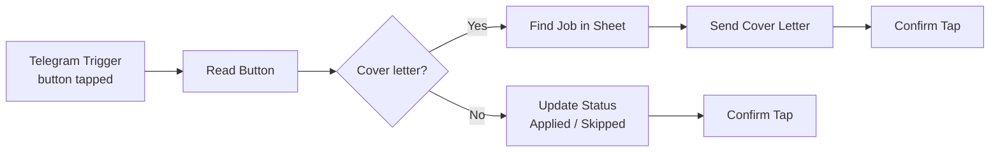
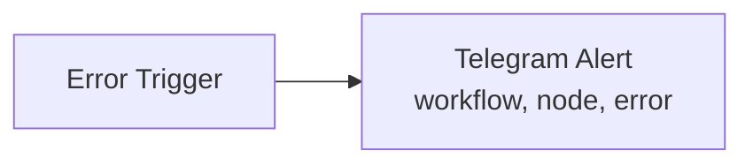
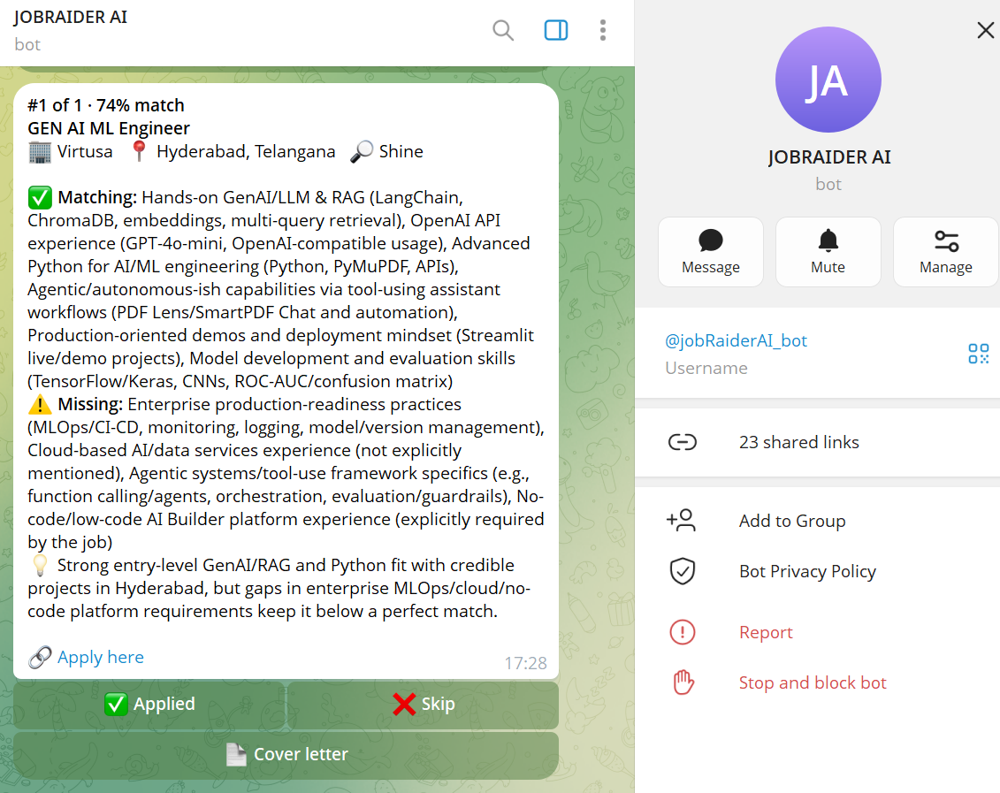

# 🎯 AI Job Hunt Assistant (n8n)

An automated job-search assistant built with **n8n** that finds fresher-friendly tech jobs every morning, scores each one against my resume using an **LLM**, writes tailored cover letters for the best matches, tracks everything in **Google Sheets**, and delivers a ranked shortlist to **Telegram** with interactive buttons.

> Instead of scrolling through dozens of listings across LinkedIn, Indeed and Glassdoor every day, I get a short list of the jobs that actually fit, ready to apply to.

---

## ✨ Features

- **Daily automation** – runs every day at 8 AM (IST) on a schedule
- **Multi-source job search** – 6 role searches via the JSearch API (Google for Jobs: LinkedIn, Indeed, Glassdoor and more)
- **Smart pre-filtering** – keeps only India/remote, entry-level tech roles; removes senior titles, non-tech roles and jobs asking for 3+ years
- **AI resume matching** – an LLM scores each job 0–100 with matching skills, missing skills and a one-line reason (structured JSON output)
- **Tailored cover letters** – generated automatically for every good match
- **Duplicate detection** – jobs already seen are skipped, so each day shows only new postings
- **Google Sheets tracker** – every job saved with score, skills, reason, cover letter and status
- **Interactive Telegram bot** – top matches arrive with buttons: ✅ Applied · ❌ Skip · 📄 Cover letter
- **Two-way updates** – tapping a button updates the job's status in the sheet instantly
- **Error alerts** – if any workflow fails, a Telegram alert says which node broke and why

---

## 🏗️ Architecture

The system is split into three focused workflows.

### 1. AI Job Hunt Assistant (main, runs daily)

```mermaid
flowchart LR
    A[Schedule Trigger<br/>8 AM daily] --> B[Config]
    B --> C[Build Queries<br/>6 role searches]
    C --> D[JSearch API]
    D --> E[Map & Filter Jobs<br/>India, entry-level, tech only]
    E --> F[Normalize Jobs<br/>create Job ID]
    F --> G[Get Saved Jobs<br/>Google Sheets]
    G --> H[Remove Already Seen]
    H --> I[AI: Score Job vs Resume<br/>structured JSON]
    I --> J{Score ≥ min?}
    J -- Yes --> K[AI: Write Cover Letter]
    K --> L[Save to Sheet<br/>Status = New]
    L --> M[Pick Top Matches<br/>Hyderabad first]
    M --> N[Telegram<br/>message + buttons]
    J -- No --> O[Save to Sheet<br/>Status = Low match]
```

### 2. Button Handler (event-driven)

### 3. Error Alert

---

## 🛠️ Tech Stack

| Area | Tools |
|---|---|
| Automation | n8n (Schedule, HTTP Request, Code, IF, Basic LLM Chain) |
| AI | OpenAI API (GPT nano/mini models) with Structured Output Parser |
| Job data | JSearch API (RapidAPI) – aggregates Google for Jobs |
| Storage | Google Sheets |
| Notifications | Telegram Bot API (inline keyboards, callback queries) |
| Code | JavaScript (data mapping, filtering, de-duplication, formatting) |

---

## 📱 Output

**Telegram message**

**Google Sheets tracker**

---

## 🚀 Setup

### Prerequisites
- An n8n instance (n8n Cloud or self-hosted)
- [OpenAI API key](https://platform.openai.com)
- [JSearch API key](https://rapidapi.com) (free Basic plan)
- A Telegram bot token from [@BotFather](https://t.me/BotFather) and your chat ID
- A Google account for Sheets

### Steps
1. **Create the tracker sheet** – make a Google Sheet with a tab named `Jobs` and paste the header row from [`sheet-template.csv`](sheet-template.csv).
2. **Import the workflows** – in n8n, create three workflows and import the files from [`workflows/`](workflows/).
3. **Add credentials** – connect OpenAI, Google Sheets and Telegram in each node that needs them.
4. **Replace placeholders**:
   - `YOUR_RAPIDAPI_KEY` → in the JSearch HTTP Request node
   - `YOUR_TELEGRAM_CHAT_ID` → in the Config node and the Error Alert workflow
   - `YOUR_SHEET_ID` → select your sheet in every Google Sheets node
   - `resume` → paste your resume as plain text in the Config node
5. **Link the error workflow** – in each workflow's Settings, set *Error Workflow* to **Job Hunt Error Alert**.
6. **Test** – set `"testMode": true` in Config and click *Execute workflow*.
7. **Go live** – set `"testMode": false`, clear the sheet, and **Publish** all three workflows.

### Configuration (Config node)

| Field | Purpose |
|---|---|
| `resume` | Your resume as plain text, used for scoring and cover letters |
| `targetRoles` | Roles the AI should score higher |
| `preferredLocations` | Preferred cities (e.g. Hyderabad, Remote) |
| `searchQueries` | Job searches separated by `\|` (max ~6/day on the free JSearch plan) |
| `minScore` | Minimum score for a job to get a cover letter and reach Telegram |
| `topN` | Number of jobs sent to Telegram per run |
| `maxJobsPerRun` | Cap on jobs scored per run (controls AI cost) |
| `testMode` | `true` skips duplicate checks for testing |

---

## 🧩 Challenges & What I Learned

- **Email alerts were unreliable as a data source.** I first parsed LinkedIn/Naukri alert emails with an LLM, but heavy HTML and inconsistent formats often produced empty results. I switched to a structured job API, which made the pipeline far more reliable and removed an entire LLM step.
- **API rate limits.** The free Gemini tier returned 429 errors when many requests fired at once. I added batching, waits and retry-on-fail, then moved to a low-cost OpenAI model.
- **Getting relevant results for a fresher.** Broad searches returned sales, medical-coding and senior roles. I added a code-level filter (title keywords, seniority, years of experience, location) *before* the AI step, which improved relevance and cut AI cost.
- **Calibrating the AI score.** A vague "be strict" prompt scored almost everything low. A clear scoring rubric with defined bands produced consistent, meaningful scores.
- **Reliable structured output.** Using a Structured Output Parser guarantees clean JSON from the LLM instead of free text.
- **Modular design.** Splitting the system into a daily pipeline, an event-driven button handler and an error workflow keeps each part simple and easy to debug.

---

## 🔮 Future Improvements

- Weekly **skill-gap report** from the most common "Missing Skills"
- **Follow-up reminders** for jobs marked Applied with no update after 7 days
- On-demand mode: send any job link to the bot for an instant score
- Store data in PostgreSQL/Supabase instead of Google Sheets

---

## 👤 Author

**M Rakesh** – B.Tech CSE graduate (2026) | AI/ML & Generative AI enthusiast

- GitHub: [your-github-username](https://github.com/your-github-username)
- LinkedIn: [your-linkedin](https://www.linkedin.com/in/your-linkedin)
